# Beatspell illustrated gameplay guide

Version: v0.6.0 internal. Updated: 12 November 2026. [中文版](GAMEPLAY.md).

Beatspell is a pixel art rhythm spellcasting Boss battle. Build spells on a continuous shared beat instead of following falling notes. This demo offers three encounter rules for the same Boss—Ritual, Duel and Gauntlet—each lasting up to 90 seconds, plus untimed practice, three defense drills and persistent records for each encounter. These are three rule sets, not three separate levels. The screenshots and diagrams below accompany the same rules as the Chinese guide; annotations in the original diagrams are Chinese, while the game screenshots show the English interface.

## Start a run

Defeat the Resonant Warden before your health or the 90-second timer runs out. All three encounters give you 5 HP and the Warden 60 HP. A four-beat count-in lasts about two seconds and is excluded from the timer. Only Ritual includes the first nine musical bars, or 18 seconds, of spell teaching; those bars count toward the timer. Use Left/Right at the title to select an encounter, then Enter, Space, J or K to start. The selection is remembered locally. Press R after a result to retry the same encounter, V to view records, or Esc to return to the title.

Spells have no mana cost or separate cooldown. Their beat patterns determine how long each action takes. Attack when safe, heal when hurt, and prepare a shield before incoming attacks.

## Choose an encounter

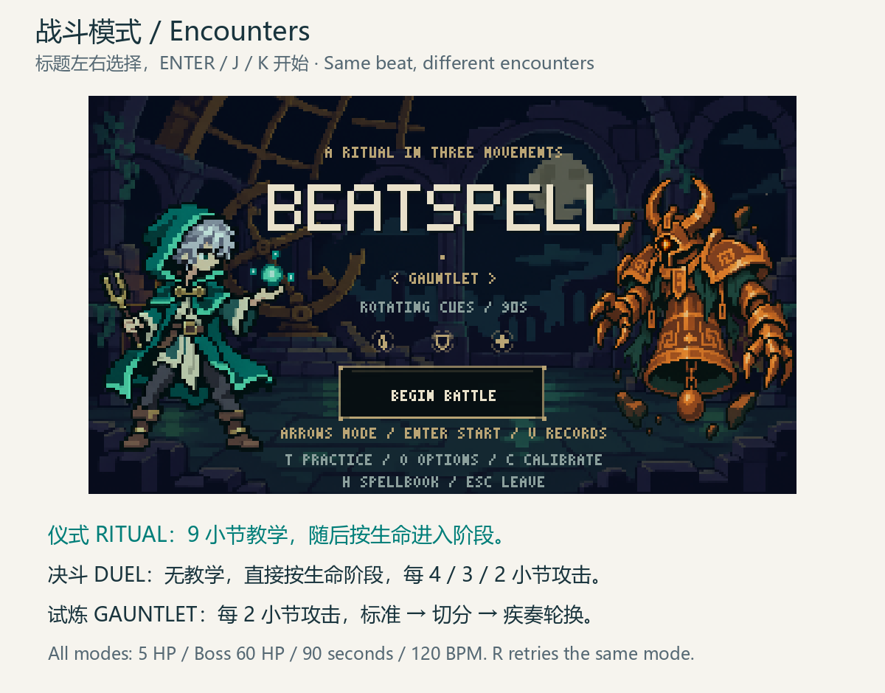

**Figure 11 — Encounter selection**

All three choices share spell recipes, musical timing, judgment windows, health and the time limit. Ritual introduces the spells, Duel removes the opening lesson, and Gauntlet tests rotating warnings under constant attack pressure. Your title selection does not change the independent practice reached with T.

| Encounter | Opening and phases | Attack schedule | Unblocked damage |
|---|---|---|---|
| RITUAL / 仪式 | Nine-bar lesson stays in phase I; health determines phases afterward | Safe bars 1–8, teaching strike at the end of bar 9; afterward every fourth/third/second global bar by phase | Phase I: 1; phases II/III: 2 |
| DUEL / 决斗 | No lesson; health determines phases immediately | Every fourth/third/second global bar by phase, with no bar-9 teaching exception | Phase I: 1; phases II/III: 2 |
| GAUNTLET / 试炼 | No lesson; health phases still display | Every second bar in every phase; Standard → Syncopated → Rush repeats | Always 2 |

Gauntlet's first three scheduled impacts occur at 4, 8 and 12 seconds after the music starts, using Standard, Syncopated and Rush respectively, then repeat. Ritual's first scheduled impact is at 18 seconds. Duel's is at 8 seconds if the Warden remains in phase I; reaching another phase earlier changes which global bars attack, so 8 seconds is not a guaranteed safe period. These times exclude the count-in.

## Controls and interface

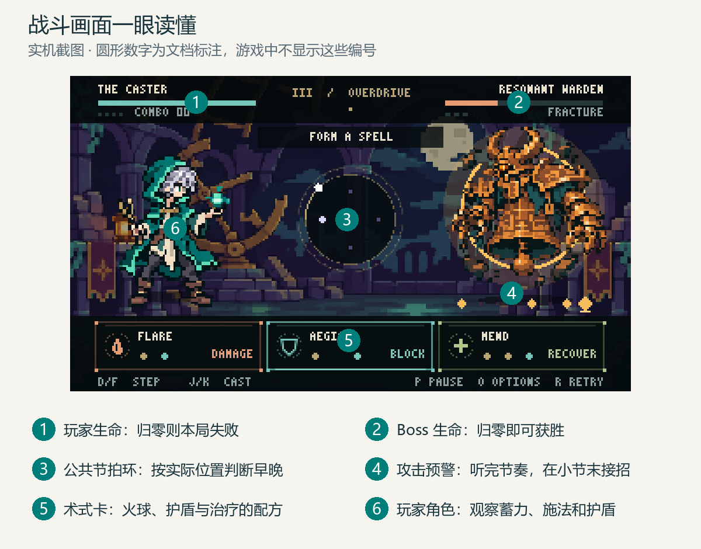

The caster is on the left and the Warden on the right. Health bars sit at the top, spell recipes at the bottom. The central ring shows musical position and input timing; the track beneath the Warden shows attack cues.

| Input | Action |
|---|---|
| D or F | Step; both keys perform the same action |
| J or K | Finish the current command and recognize a spell |
| Enter or Space | Start the selected encounter from the title; J/K also start |
| T | Enter practice from the title; after lessons, toggle free practice and defense drills |
| Left / Right | Select an encounter at the title; queue a defense pattern for the next bar during drills |
| V | Open records from the title or result; V/Esc returns to the original page |
| Tab | Open a paused training report; Tab or Esc closes to pause; P resumes |
| P | Pause / resume |
| R | Restart the current mode, including practice lessons |
| H | Open the spellbook and pause |
| O | Open options and pause |
| C | Leave the current run and enter audio calibration |
| Esc | Return to title; quit from title |

Xbox-style controller face buttons X/Y perform steps, and A/B finish spells. Menus and options currently use the keyboard. Closing the spellbook or options during a run leaves the game paused; press P to resume. Records open only from the title or a result. While records are open, only V/Esc returns; other keys cannot start, restart or select an encounter. Closing restores the same title or result.

## The continuous timing ring

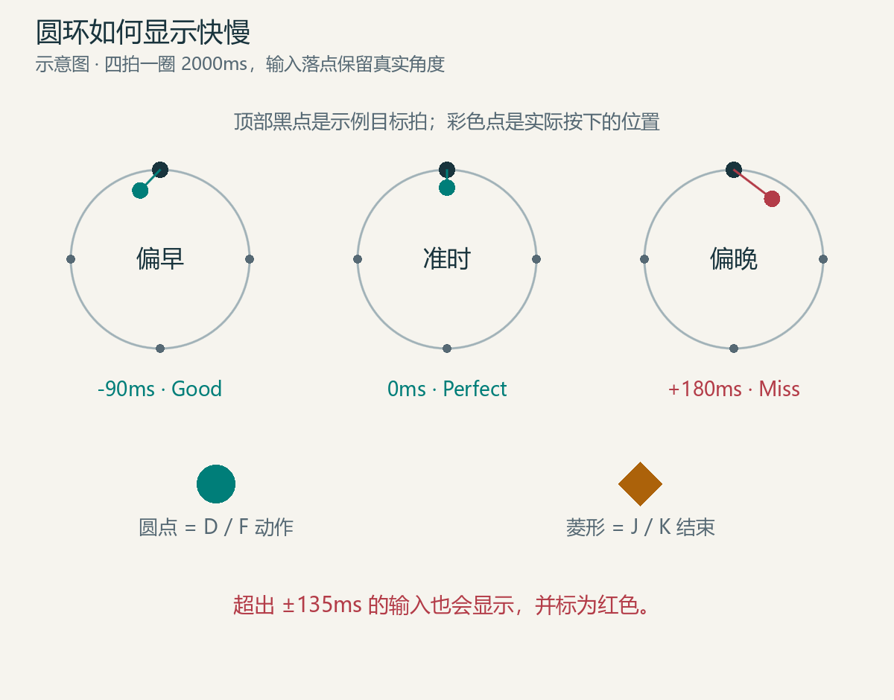

The music runs at 120 BPM: 500 ms per beat, four beats per bar and 2,000 ms per revolution. The ring moves clockwise through top, right, bottom and left. Start on any whole beat. Starting, finishing or failing a spell never resets the global ring.

Input marks show the actual angle when you pressed. A mark before the nearest beat is early; after it is late. Thin connecting lines show the error. Steps use circles, spell finishes use diamonds, and mistakes remain visible in red. Marks do not snap to beat positions. Active commands retain their trail; finished trails remain for 650 ms and fade together over another 350 ms.

Perfect timing is within ±55 ms; Good is within ±135 ms. An active command expires more than 3.25 beats, or 1,625 ms, after its first target beat. Off-window or duplicate inputs can break the command; expiration also breaks the combo.

## Three spell recipes

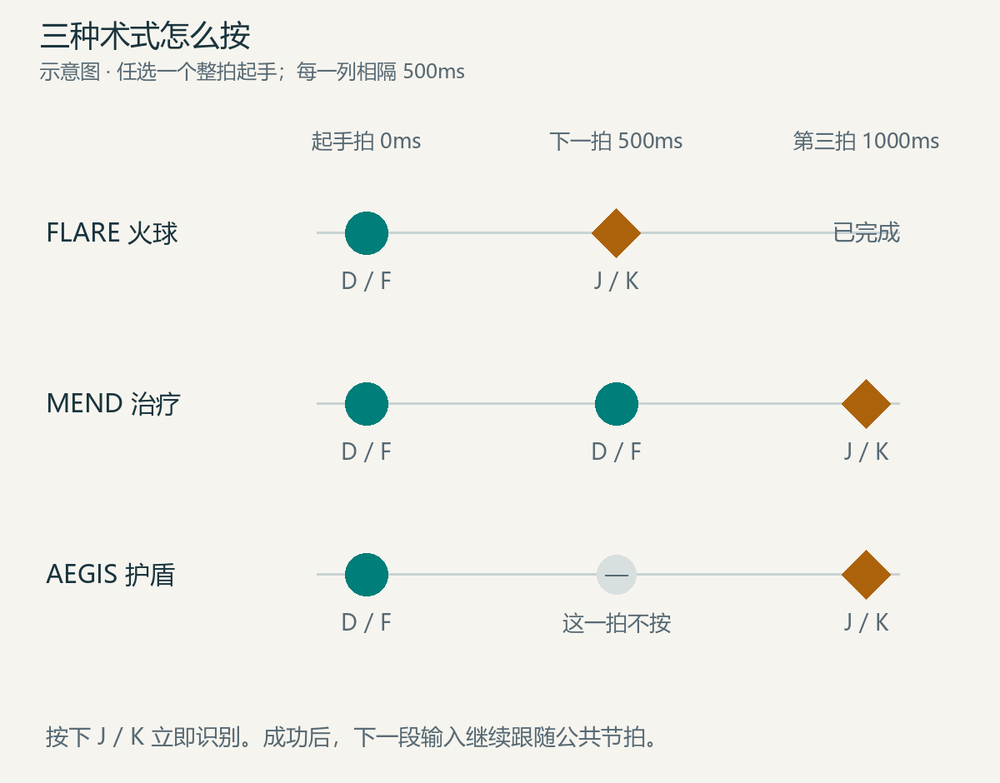

| Spell | Whole-beat pattern | Effect |
|---|---|---|
| FLARE / 炎击 | Step → finish | Perfect: 2 damage; Good: 1 |
| MEND / 回春 | Step → step → finish | Perfect: heal 2; Good: heal 1, capped at 5 HP |
| AEGIS / 护盾 | Step → rest → finish | One shield blocks the next attack |

For FLARE, press D on one beat and J on the next. For MEND, use D, D, J on three successive beats. For AEGIS, use D, leave the next beat empty, and press J on the third. F can replace D and K can replace J. The whole command receives a spell grade; an incorrect combination fails. Refreshing AEGIS replaces the existing shield rather than stacking shields.

## Guard, fracture and resonance

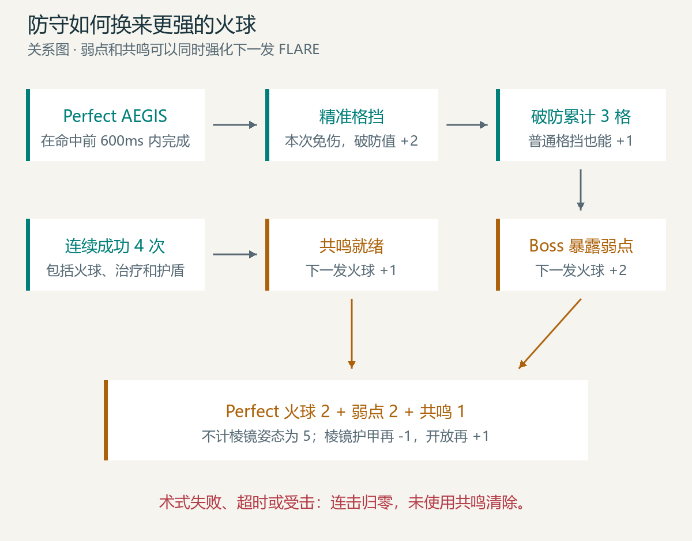

A shield blocks one attack. A Perfect AEGIS completed within the last 600 ms before impact produces a **Perfect Guard**. Earlier Perfect shields and Good shields still block, but do not count as Perfect Guards. Play before impact: when an input coincides exactly with a bar boundary, the scene resolves the attack before processing the new input.

An ordinary block adds 1 fracture point; a Perfect Guard adds 2. At 3 points the Warden becomes exposed. The next FLARE gains +2 damage and consumes exposure. Four successful consecutive spells prime resonance for +1 damage on the next FLARE; later multiples of four can prime it again. Exposure and resonance stack. Errors, expired commands and taking damage clear the current combo and resonance.

## Boss phases and warnings

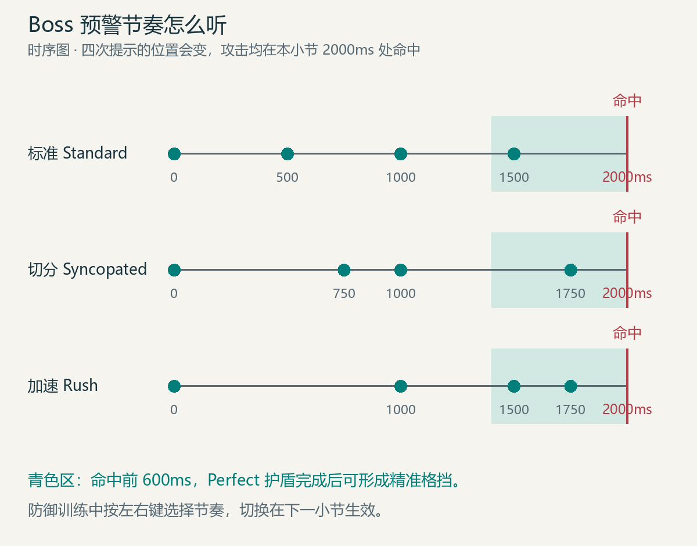

Ritual's first nine bars stay in phase I. Its bars 1–8 have no attacks; bar 9 ends with a teaching attack. Afterward health determines its phase. Duel and Gauntlet follow health from the start. The phase updates at each new bar; damage during a bar does not change that bar's phase or warning. The table's attack cadence and damage apply to Ritual after teaching and to Duel. Gauntlet always attacks every second bar for 2 unblocked damage.

| Phase | Health | Attack bars | Damage |
|---|---|---|---|
| I / AWAKENING | Above two-thirds (41–60 HP) | Every fourth global bar | 1 |
| II / FRACTURE | Above one-third, up to two-thirds (21–40 HP) | Every third global bar | 2 |
| III / OVERDRIVE | Up to one-third (1–20 HP) | Every second global bar | 2 |

Global bar numbering continues through phase changes; the first attack in a new phase may arrive sooner than a full four, three or two bars. Duel has no safe teaching bars or special strike at bar 9. During an attack bar, four visual and audible cues lead to impact at the end of the bar, 2,000 ms after its start.

| Pattern | Cue offsets from bar start | Feel |
|---|---|---|
| STANDARD | 0, 500, 1,000, 1,500 ms | Even beats |
| SYNCOPATED | 0, 750, 1,000, 1,750 ms | Alternating long and short gaps |
| RUSH | 0, 1,000, 1,500, 1,750 ms | Waiting first, then accelerating |

For Ritual and Duel, phase I uses Standard, phase II alternates Standard and Syncopated, and phase III alternates Syncopated and Rush. Ritual's teaching strike always uses Standard. Gauntlet cycles Standard → Syncopated → Rush by attack count, independently of health phase. The final cue is not the impact. The Warden winds up during the final 600 ms and strikes at impact.

## Lessons and practice

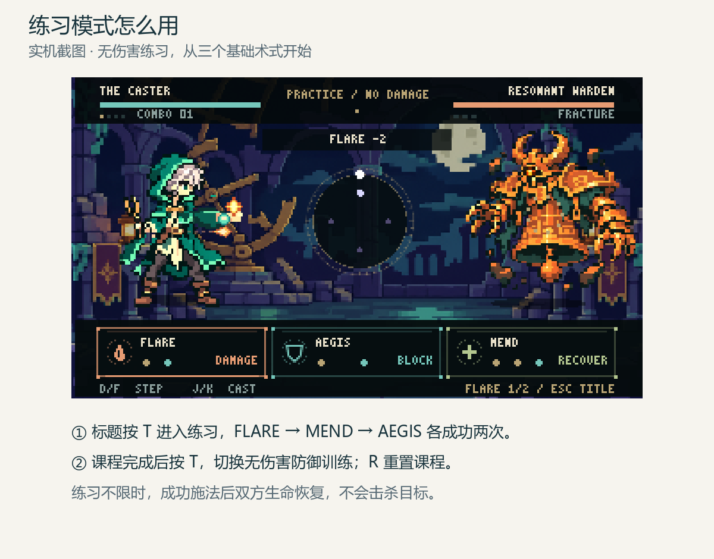

Only Ritual includes battle lessons: bars 1–3 introduce FLARE, bars 4–6 MEND, and bars 7–9 AEGIS. These lessons advance with time; they do not wait for successful casts, and any valid spell remains available. Duel and Gauntlet skip this introduction.

Press T at the title for untimed, damage-free practice, independently of the selected encounter. Successfully cast FLARE twice, then MEND twice, then AEGIS twice in their respective lessons. Casting another lesson's spell early does not complete that future lesson. Successful spells restore both sides to full health, so the target cannot be defeated. The footer shows lesson progress. R restarts all lessons and Esc returns to the title.

### Defense drills and report

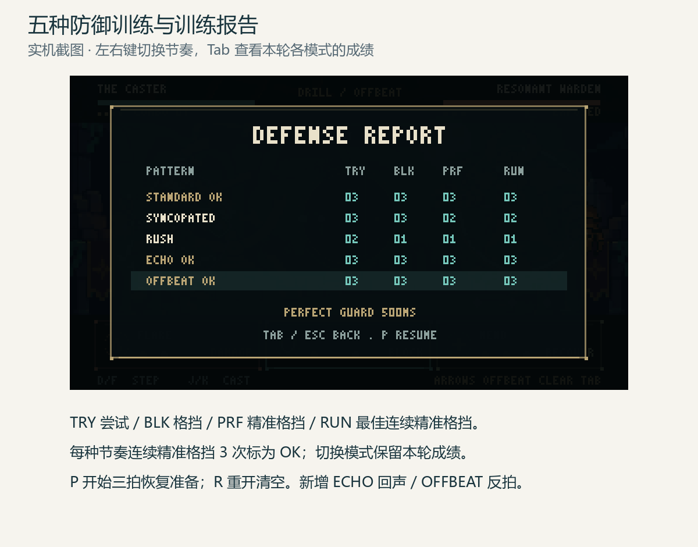

After completing all lessons, press T to toggle defense drills. An attack happens every two bars without damaging the player. Entry waits for a complete future warning bar. Left and Right select Standard, Syncopated or Rush; the selection takes effect at the next bar, allowing any current warning to finish unchanged. A new pattern removes the old shield while preserving the global ring.

Each pattern separately tracks attempts, blocks, Perfect Guards, current streak and best streak. Three consecutive Perfect Guards clear a pattern. A later ordinary block or miss resets its current streak, while the cleared status remains. These three consecutive guards are a separate goal from the three-point fracture meter.

Tab opens the paused report. TRY means attempts, BLK blocks, PRF Perfect Guards and RUN the best consecutive Perfect Guard streak. A cleared row displays OK. The last outcome explains the shield: PERFECT GUARD succeeded; EARLY SHIELD was a Perfect spell completed too early; GOOD SHIELD had a Good spell grade; NO SHIELD means none was active. The displayed milliseconds measure shield completion to impact.

Tab or Esc closes the report to pause. P resumes directly, including from the report; R restarts the lessons and drill records. T returns to free practice. Switching patterns or toggling drills preserves this round's records; restarting or leaving practice begins a new round. These drill records are temporary and do not enter the permanent battle records described below. Drills reproduce warnings without a normal battle's damage or phase pressure.

## Language, options and calibration

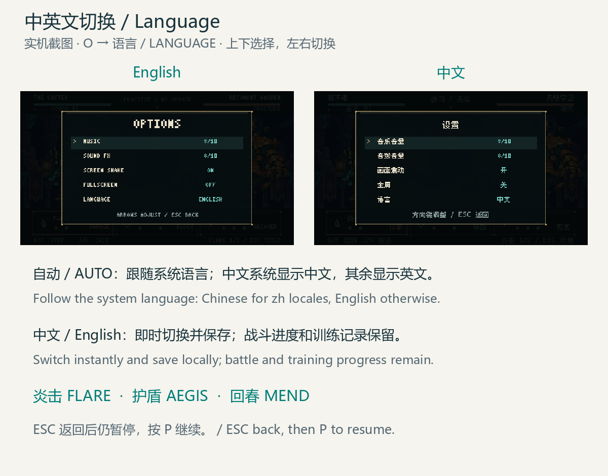

Press O, move Up/Down to LANGUAGE, then use Left/Right, Enter or Space to cycle **AUTO / 中文 / English**. AUTO uses Simplified Chinese on Chinese system locales and English otherwise. The preference takes effect immediately and saves locally. Switching preserves the active command, training records and battle position. Esc returns to pause; P resumes.

Both languages cover the title, encounters, combat feedback, phases, spellbook, practice, training reports, persistent records, results and calibration. FLARE is 炎击, AEGIS 护盾 and MEND 回春. Chinese glyphs are bundled; no installed Chinese font is required.

Options also adjust music, sound effects, screen shake and fullscreen. Volumes range from 0% to 100% in 10% steps, both defaulting to 80%. Shake defaults on; fullscreen defaults off. Changes save immediately on the current computer.

Calibration uses a separate 100 BPM metronome, or 600 ms per beat. Press D with the clicks to collect eight samples on distinct nearest beats. Pre-roll taps, repeated taps on the same beat and backwards beats are ignored; skipping a beat is allowed. Enter saves the completed result, R retries and Esc returns without saving. Entering calibration leaves the current run.

The calculation rejects samples more than 120 ms from the initial median, then uses the remaining median and clamps the result to ±300 ms. Battle judgment uses music time minus the saved offset. A positive offset compensates for consistently late inputs. Recalibrate after changing headphones or audio outputs.

## Results and rank

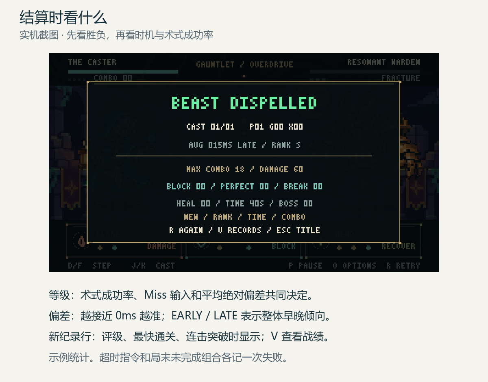

CAST displays successful spells / attempts; P, G and X show Perfect, Good and failed spells. AVG is the mean absolute timing error across recorded step and finish inputs, rounded to milliseconds. The screen also reports the highest combo, effective damage and healing, blocks, Perfect Guards, breaks, elapsed time and remaining Boss HP.

The HUD keeps the current encounter visible above the result. Its final line shows NEW and the improved categories RANK, TIME or COMBO. Completing the first run establishes a rank from an empty record and uses the same new-record message. R retries the same encounter; V opens records and returns to the same result. Reopening the result or records never counts the run again.

| Rank | Conditions |
|---|---|
| S | At least 90% spell success, no Miss inputs, mean absolute error ≤45 ms |
| A | Does not meet S; at least 75% success and error ≤80 ms |
| B | Does not meet a higher rank; at least 50% success and error ≤120 ms |
| C | All other runs, including no spell attempts |

Success rate is successful spells divided by attempts. Mean signed error below −8 ms gives EARLY, above +8 ms gives LATE, and otherwise ON TIME. Rhythm rank and victory are separate, so a lost run can still receive a high rank.

An expired active command counts as one failed attempt. A command still active at the end of a battle also counts once. Clearing prevents duplicate failures. Neither case invents a physical input; actual off-window inputs still contribute to input error and Miss statistics.

## Persistent local records

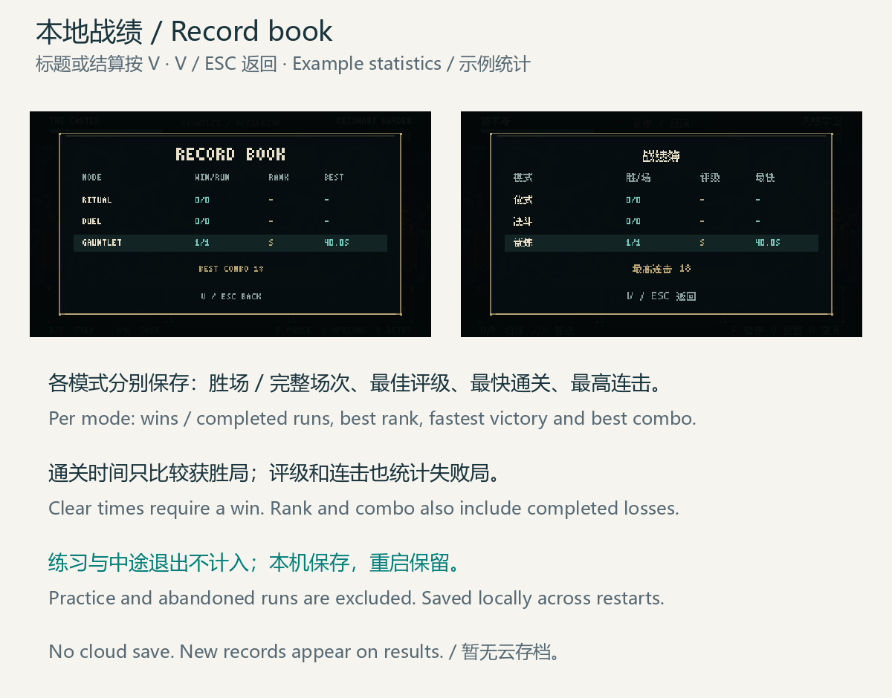

**Figure 12 — Persistent local records**

Press V from the title or a result to view separate Ritual, Duel and Gauntlet records. V/Esc returns to the original page. Completed runs are whole battles, unlike the spell-attempt count shown on the result. Victories, defeats and timeouts count as completed runs; only defeating the Warden adds a win.

| Record | Saved behavior |
|---|---|
| Completed runs and wins | Each finished battle counts once, separately for each encounter |
| Best rank | Highest of S/A/B/C; defeats and timeouts can improve it |
| Fastest clear | Winning runs only, measured from music start to Boss defeat, excluding count-in |
| Best combo | Highest successful-cast streak in any completed battle, including losses |

Leaving for the title, restarting before a result, leaving for calibration, independent practice and defense drills do not count toward completed battles or these records. Encounter records remain separate because their attack pressure differs.

Record counters above 999 display as 999+, while saves store integers capped at 999999. Clear times display to 0.1 seconds, but a new fastest clear is decided using exact saved music milliseconds. Two runs can therefore display the same time while one improves the record. Establishing the first rank and improving any record produces the corresponding new-record message. The interface also reports save failures; a save-failure message means the record should not be assumed written to disk.

Records persist on the current computer in `user://run-records.json`. There is no cloud save and the GitHub repository does not transfer player records to another computer. The defense training report remains temporary for the current practice round.

## Art, audio and interaction

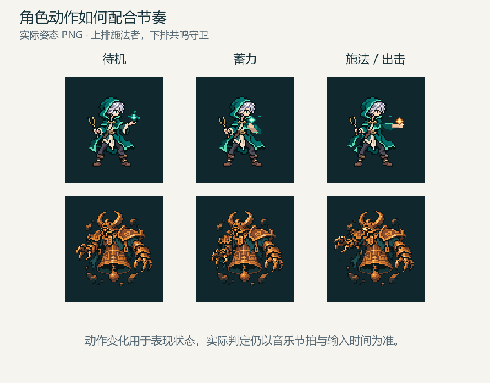

The game renders at a real 320×180 viewport with nearest-neighbor sampling and integer scaling. The moonlit observatory, neutral caster and brass Warden use a 16-bit pixel direction. Each character has three actual pose PNGs: caster idle, charge and cast; Warden idle, windup and strike. Pose changes communicate state; music time still determines judgment.

Audio includes 120 BPM music stems and 14 original WAV effects for inputs, spells, cues, guards, impacts, errors, breaks and results. English uses the original handmade glyphs; Chinese uses unmodified Fusion Pixel 8px and 10px fonts. Font notices and upstream licenses are in `assets/fonts/fusion-pixel/` and the portable build's `FONT_LICENSES/`.

Keep interactions restrained: start on any whole beat, preserve the continuous ring, show true input timing and retain visible errors. Additional effects should make casts and attacks easier to read without obscuring the ring.

## Numeric reference

| Parameter | Value |
|---|---|
| Battle tempo | 120 BPM |
| Beat / bar | 500 ms / four beats / 2,000 ms |
| Count-in | Four beats, about two seconds |
| Battle limit | All encounters: 90 seconds excluding count-in |
| Encounters | Ritual / Duel / Gauntlet: three rule sets for the same Boss |
| Tutorial | Ritual only: nine bars, 18 seconds; none in Duel or Gauntlet |
| Ritual / Duel attacks | Every fourth/third/second global bar by health phase; Ritual has a teaching strike at bar 9 |
| Gauntlet attacks | Every second bar, damage 2; Standard → Syncopated → Rush repeats |
| First three Gauntlet impacts | 4, 8 and 12 seconds after music start, excluding count-in |
| Player / Boss HP | 5 / 60 |
| Perfect / Good window | ±55 ms / ±135 ms |
| Command expiry | More than 1,625 ms after first target beat |
| FLARE damage / MEND healing | Perfect 2; Good 1 |
| Perfect Guard | Perfect AEGIS completed 0–600 ms before impact; play before the boundary |
| Fracture threshold | 3; ordinary block +1, Perfect Guard +2 |
| Exposure / resonance bonus | Next FLARE +2 / next FLARE +1; stackable |
| Resonance threshold | Each multiple of four successful consecutive casts |
| Finished trace hold / fade | 650 ms / 350 ms |
| Defense drill attack / clear | Every two bars / three consecutive Perfect Guards per pattern |
| Calibration | 100 BPM, eight distinct beats, offset ±300 ms |
| Languages | AUTO / 中文 / English; AUTO by default |
| Persistent records | Per-encounter completed runs, wins, best rank, fastest win and best combo; practice and abandoned runs excluded |
| Record display / comparison | Counters above 999 show 999+, stored cap 999999; times display 0.1 seconds and compare exact milliseconds |
| Record storage | Local user://run-records.json; no cloud synchronization |

## Future development

These are planned or unverified directions, rather than implemented features: collect device and beginner playtest data; refine pixel animations, attack readability and audio balance; improve onboarding; test wired, Bluetooth and speaker latency. More levels and Steam release preparation follow once the current Boss experience is stable. The three encounters are rules for the same Boss, not three new levels. The earlier two-chapter band prototype is separate from the current Boss demo.

## Maintenance and sources

Update this guide, the [Chinese guide](GAMEPLAY.md), relevant figures, CHANGELOG and `PROJECT_HANDOFF.md` whenever controls, timing, spells, Boss rules, settings or scoring change. The existing online Page is the editable Chinese companion with links to both public language versions; preserve user edits when synchronizing it.

Rules are implemented in `scripts/beatspell/timing_profile.gd`, `spell_command_buffer.gd`, `battle_model.gd`, `battle_director.gd`, `practice_director.gd`, `defense_drill.gd` and `performance_tracker.gd`. Encounter schedules are in `encounter_rules.gd`; permanent record validation and persistence are in `run_records.gd`. Language strings and fallback rules are in `localization.gd`; settings and calibration are in `scripts/settings/`. [Current code and tests](https://github.com/fatjiao/beatspell-game/tree/main) ship with the guide.
