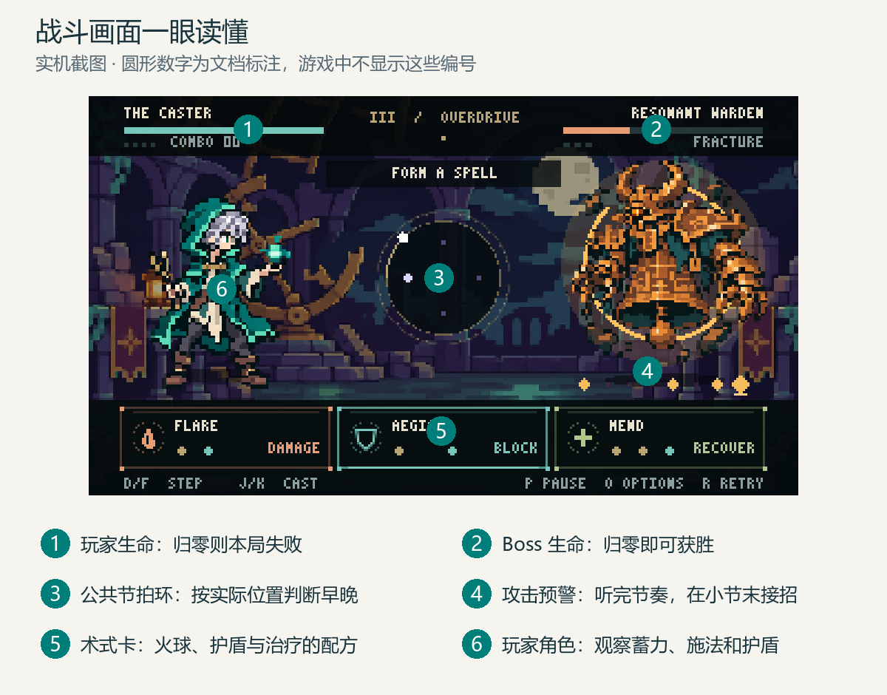
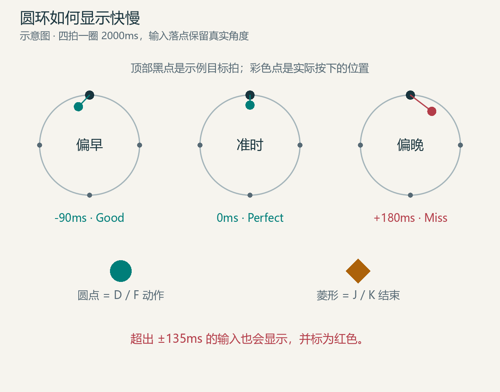
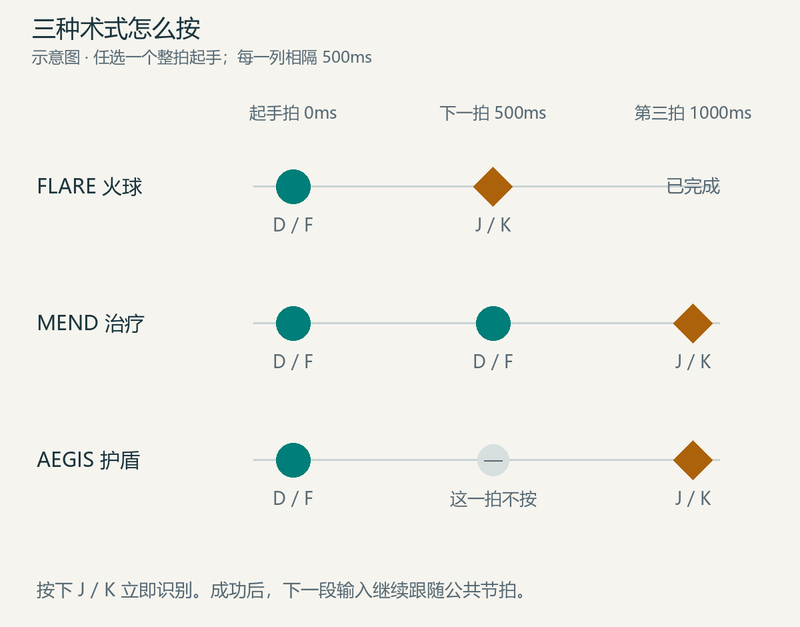
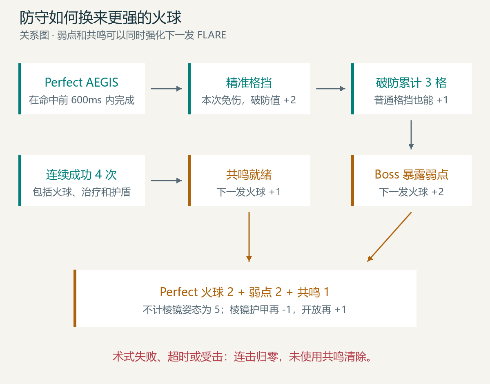
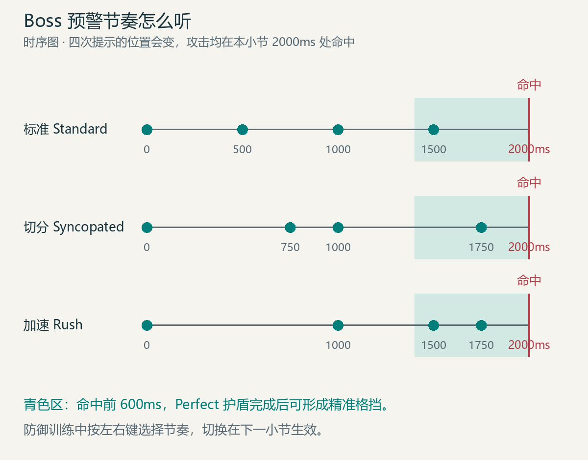
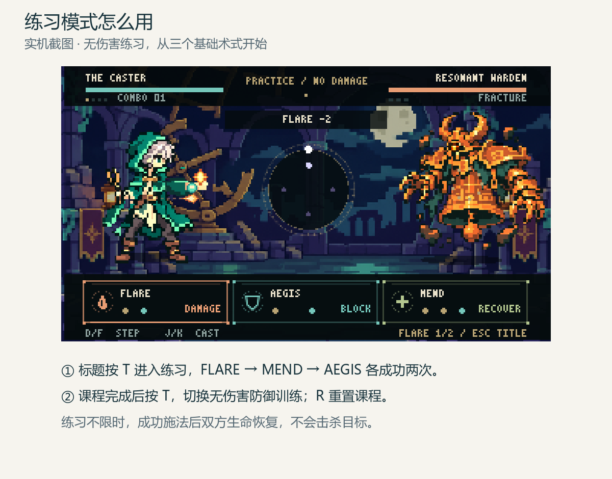
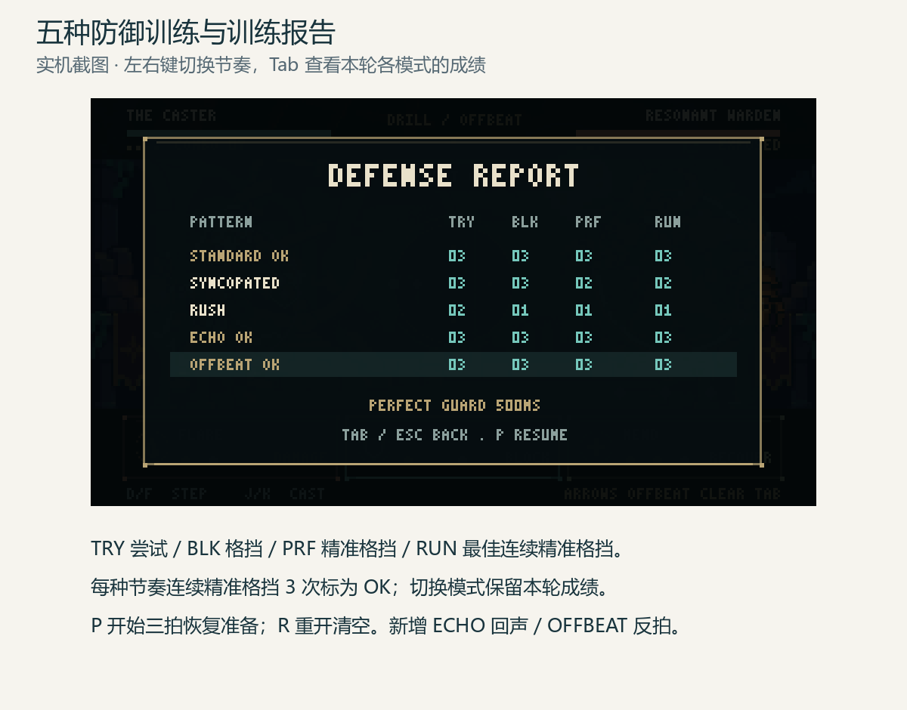
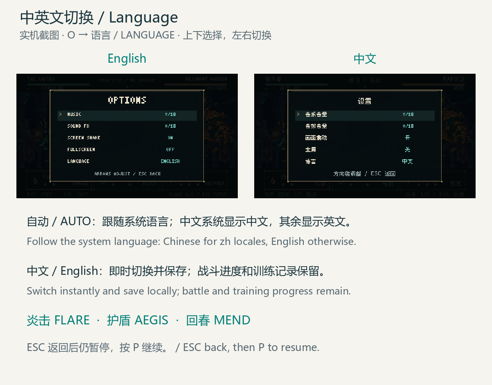
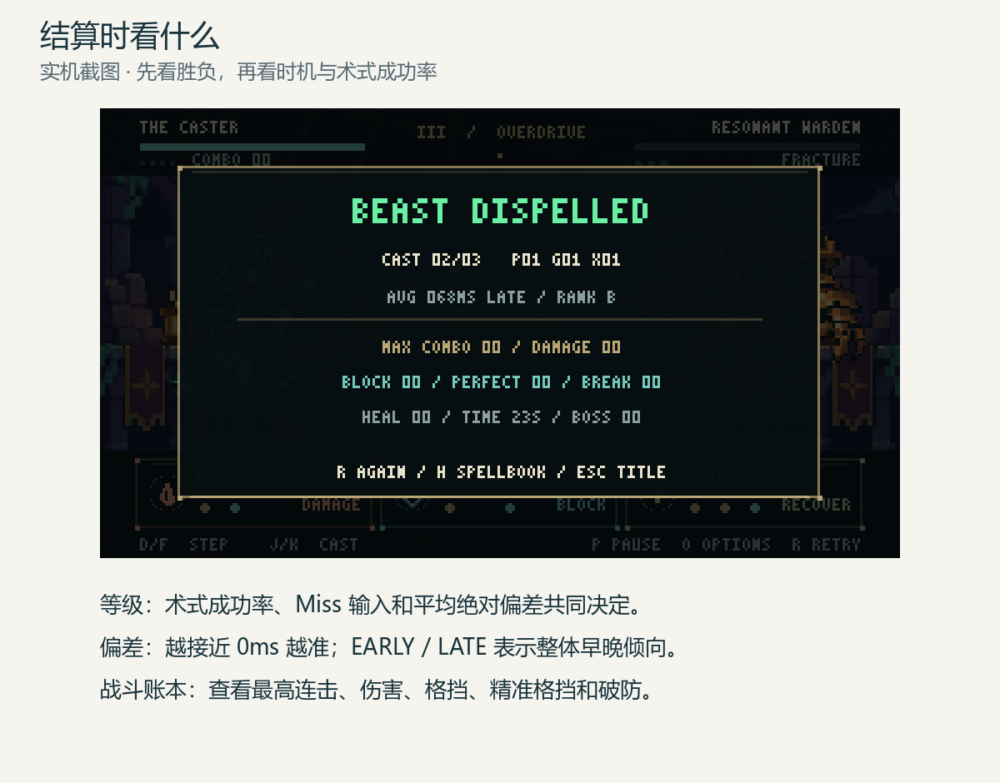
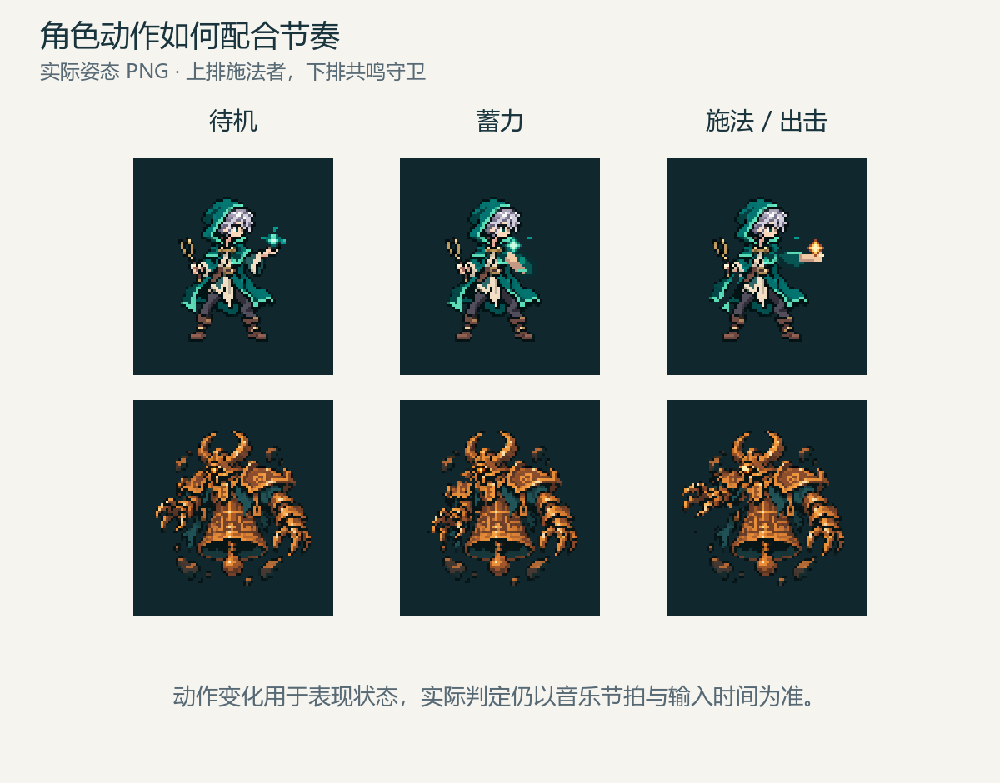

# Beatspell 游戏玩法图文说明

当前版本：v0.5.0 internal。更新日期：2026年11月12日。

语言版本：中文 · [English illustrated guide](GAMEPLAY.en.md)。游戏内按 O 打开设置，可选自动／中文／English。

Beatspell 是一款像素风节奏施法 Boss 战游戏。玩家跟随持续运行的公共节拍，组合动作并结束术式，在进攻、治疗和格挡之间选择。当前 Demo 包含一场最长 90 秒的战斗，以及独立练习和防御训练。

按章节结合配图阅读：先认识战斗界面和节拍落点，再跟着时序图输入三个术式，最后理解防守、增伤和 Boss 预警。“后续开发方向”单独列出尚未实现内容。

# 游戏目标与单局流程

在生命耗尽或 90 秒时限结束前，将共鸣守卫的生命降为 0 即可获胜。玩家初始和最大生命为 5，Boss 初始生命为 60。正式战斗的教学阶段计入 90 秒。

标题界面开始后先进行四拍倒计时，约 2 秒；随后音乐、节拍环与战斗计时开始。前 9 小节共 18 秒是术式引导，之后根据 Boss 剩余生命进入不同阶段。胜负出现后音乐暂停，显示本局统计，按 R 重开或 Esc 回到标题。

核心决策是：保持节奏完成术式，在攻击前准备护盾，在受伤时治疗，在破防和共鸣就绪时用火球输出。术式本身没有蓝量消耗和独立冷却；输入所占用的拍数构成行动成本。

# 操作与界面

**图 1 战斗界面标注**

先认识六个区域：生命决定胜负，圆环用于看节拍和输入误差，Boss 下方的轨道用于听懂攻击进程。图中的编号是说明层，不是游戏内提示。

| 输入 | 当前作用 |
|---|---|
| D 或 F | 动作键，两键完全等价 |
| J 或 K | 结束当前组合并立即识别术式，两键完全等价 |
| Enter 或 Space | 标题界面开始正式战斗 |
| T | 标题进入独立练习；课程完成后切换自由练习与防御训练 |
| 左右方向键 | 防御训练中选择标准、切分和 Rush，下一小节生效 |
| Tab | 练习中打开训练报告；Tab 或 Esc 关闭到暂停页，P 继续 |
| P | 暂停或继续 |
| R | 重开当前模式，练习课程也会重置 |
| H | 打开术式手册；战斗中自动暂停 |
| O | 打开设置；战斗中自动暂停 |
| C | 进入音频校准页，离开当前战斗 |
| Esc | 战斗回标题；标题退出游戏 |

手柄面键 X 或 Y 对应动作，A 或 B 对应施法，均采用 Xbox 常见标注。当前菜单和设置主要使用键盘。

画面左侧为玩家，右侧为守卫，上方为双方生命、连击和破防状态；中央圆环显示节拍和实际输入位置，底部为三种术式的配方卡。Boss 下方的短轨道显示攻击预警。

术式手册按 H 或 Esc 关闭；战斗会保留在暂停状态，按 P 继续。设置页关闭后同样需要按 P 继续。

# 公共节拍与实时落点

**图 2 偏早 准时与偏晚**

三幅图以顶部目标拍作对照。输入点在到达目标之前表示按早，经过目标之后表示按晚；图标位置不会为了显示好看而吸附到整拍。红色示例已经超出有效窗口。

当前战斗速度固定为 120 BPM，一拍 500ms，四拍一小节，圆环一圈 2000ms。圆环从顶部开始，顺时针经过右、下、左四个整拍位置。

玩家可以在任意整拍开始术式，例如圆环右侧或左侧都能起手。起手、结束术式和失误都不会重置公共圆环，内圈也不会每次从顶部重新排列。

输入图标记录实际按下的角度，不吸附到目标拍点。目标点之前表示偏早，之后表示偏晚；连接目标点的细线表达误差方向和距离。动作使用小圆点，结束使用菱形，失误保留红色标记。

进行中的术式轨迹持续显示。结束后整组轨迹停留 650ms，再用 350ms 一起渐隐。普通按键不逐次弹出中央文字，识别结果和 Boss 攻击仍有简短反馈。

# 三种术式与输入示例

**图 3 三种术式逐拍输入**

从左到右跟着列读：火球是动作后下一拍结束；治疗是连续两次动作再结束；护盾的中间一拍不输入。三种配方都能从任意整拍开始。

下表用“动作”表示 D 或 F，用“结束”表示 J 或 K。“空拍”表示该拍不输入；示例时间均以任意一个整拍为 0ms，不要求从小节顶部开始。

| 术式 | 第一个整拍 | 下一个整拍 | 再下一个整拍 | 结束所需时间 |
|---|---|---|---|---|
| FLARE 火球 | 动作 | 结束 | 已完成 | 500ms |
| MEND 治疗 | 动作 | 动作 | 结束 | 1000ms |
| AEGIS 护盾 | 动作 | 空拍 | 结束 | 1000ms |

例如 FLARE 可以在 1000ms 按 D、1500ms 按 J；MEND 可以在 1500ms 按 F、2000ms 按 D、2500ms 按 K，跨过小节边界仍然有效。AEGIS 可以在 2000ms 按 D、2500ms 不按、3000ms 按 J。

| 术式 | Perfect 效果 | Good 效果 | 使用限制 |
|---|---|---|---|
| FLARE | 基础伤害 2 | 基础伤害 1 | 可叠加破防和共鸣增伤 |
| MEND | 恢复 2 点生命 | 恢复 1 点生命 | 上限为 5，满血施放仍计为成功术式 |
| AEGIS | 准备抵挡下一次攻击 | 同样准备抵挡下一次攻击 | 单层护盾，重复施放刷新时间和判定等级 |

AEGIS 不提供可叠加护盾层数，护盾持续到下一次攻击将其消耗。Perfect 护盾还需要满足攻击前的时间窗口，才能形成精准格挡。

# 节奏判定与失误恢复

| 单次输入相对最近整拍的偏差 | 判定 |
|---|---|
| 绝对值不超过 55ms | Perfect |
| 大于 55ms 且不超过 135ms | Good |
| 大于 135ms | Miss |

负偏差表示按早，正偏差表示按晚。一个有效术式所有输入都是 Perfect 时，整次术式为 Perfect；至少一个输入为 Good、其余有效时，整次术式为 Good。

同一拍重复按动作、在动作之前或同拍结束、节奏结构不匹配，都会导致失败。进行中出现超窗输入会破坏当前组合；最后按结束时统一识别为失败并清空。空着组合直接按结束也算一次失败施法。

第一枚有效动作对应的目标拍过去 3.25 拍，即 1625ms 后，未完成的指令会过期。错误组合结束或过期后可重新起手，公共圆环继续运行。施法没有额外等待小节结束的锁定。

当前实现中，一枚在没有有效组合时按下的超窗动作会显示为红色输入，但不会建立有效组合；下一次有效动作可以起手。连击在失败施法、有效组合过期或未挡住攻击时清除。

# 格挡 破防与共鸣

**图 4 精准格挡 破防与增伤关系**

精准格挡积累破防值，满三格才触发弱点；连续成功施法准备共鸣。两条增伤路线可以汇合到同一发火球，Perfect 时理论伤害为 5。

## 普通格挡与精准格挡

持有护盾时，下一次 Boss 攻击消耗护盾并完全抵挡本次伤害，成功格挡保留连击。

精准格挡需要同时满足：AEGIS 整次术式为 Perfect，且施法完成时间位于攻击命中前 0 到 600ms 内，边界包含在内。判断使用音乐时间。比如攻击在 24000ms 命中，Perfect AEGIS 在 23400ms 至 24000ms 完成，才满足模型中的这个窗口；更早完成仍可普通格挡。场景会先结算已经到达的小节边界攻击，因此实操应提前一拍完成，避免在命中瞬间才按结束。

操作上可在攻击前的倒数第三拍起手，空一拍，在倒数第一拍结束。例如 22500ms 动作、23000ms 空拍、23500ms 结束，用于抵挡 24000ms 的攻击。

## 三格破防

普通格挡积累 1 格破防值，精准格挡积累 2 格；达到 3 格后，破防条归零，Boss 暴露弱点。下一发成功 FLARE 额外造成 2 点伤害并消耗弱点。

两次精准格挡即可达到破防条件。溢出格数不会结转；Boss 已经暴露弱点时，继续格挡不会再积累破防值。输入失败或受击不会直接清除现有破防值与已触发的弱点。

## 四连击共鸣

连续成功施法累计到 4 的倍数时，共鸣就绪，使之后的一发 FLARE 额外造成 1 点伤害。共鸣是单个就绪状态，不能储存多层；使用火球会消耗已有共鸣。该发火球若又使连击达到 4 的倍数，会重新准备下一次共鸣。

失败施法、指令过期和未挡住攻击会将连击归零并清除未使用共鸣。治疗即使满血、护盾即使覆盖旧盾，也属于成功施法，可以累积连击。

| FLARE 情况 | Perfect 伤害 | Good 伤害 |
|---|---|---|
| 基础 | 2 | 1 |
| 只有弱点 | 4 | 3 |
| 只有共鸣 | 3 | 2 |
| 弱点与共鸣都有 | 5 | 4 |

伤害统计只计实际扣除的生命，治疗统计只计实际恢复的生命。例如 Boss 只剩 1 点生命时，5 点理论伤害实际记为 1。

# Boss 阶段与攻击预警

**图 5 Boss 三种预警时序**

四个圆点都是 Boss 的声音和视觉提示，不要求玩家逐点模仿。三种预警的最终命中点相同；护盾应提前完成，别把最后一声误当作攻击命中。

前 9 小节固定第一阶段。教学结束后，在每个新小节开始时按当前生命确定阶段；当前小节的阶段与攻击预警保持一致，玩家造成伤害不会使它在小节中途改变。

| 阶段 | Boss 剩余生命 | 名称 | 攻击小节安排 | 未格挡伤害 |
|---|---|---|---|---|
| 一 | 41 至 60 | AWAKENING | 正常进程中，小节编号为 4 的倍数时攻击 | 1 |
| 二 | 21 至 40 | FRACTURE | 小节编号为 3 的倍数时攻击 | 2 |
| 三 | 1 至 20 | OVERDRIVE | 小节编号为 2 的倍数时攻击 | 2 |

表中小节编号从 1 开始。教学期间第 1 至第 8 小节不攻击，第 9 小节末固定进行教学攻击。进入新阶段后沿用全局小节编号，因此首次攻击并不一定要等待完整的 4、3 或 2 个小节。

攻击小节持续发出四个声音和视觉提示，在该小节结束时命中。以下时间是相对本攻击小节开始的偏移，最终命中点都是 2000ms。

| 预警节奏 | 四次提示时间 | 聆听特点 |
|---|---|---|
| Standard 标准 | 0、500、1000、1500ms | 均匀四拍 |
| Syncopated 切分 | 0、750、1000、1750ms | 长短交错 |
| Rush 加速 | 0、1000、1500、1750ms | 前段等待，后段越来越密 |

第一阶段使用标准预警；第二阶段标准和切分交替；第三阶段切分和 Rush 交替。最后一次提示与攻击命中之间的间隔会变化，不能将“最后一个提示”直接当作命中点。

守卫在预警小节最后 600ms 显示蓄力姿态，攻击时切换出击姿态，配合冲击碎片和震动。

# 教学与练习模式

**图 6 独立练习实机说明**

截图底部的 FLARE 1/2 表示本课程已经成功一次，还需要再成功一次。三种课程完成后，按 T 可以切换防御训练，专门练习护盾与精准格挡。

## 正式战斗内教学

| 小节 | 音乐开始后的时间 | 引导术式 |
|---|---|---|
| 1 至 3 | 0 至 6 秒 | FLARE |
| 4 至 6 | 6 至 12 秒 | MEND |
| 7 至 9 | 12 至 18 秒 | AEGIS |

该教学按时间推进，不要求完成指定次数才进入下一段。第 9 小节末进行一次攻击，用来验证护盾；玩家在教学中仍可施放任何有效术式。

## 独立练习

标题按 T 进入，无伤害、无时限，音乐循环。按 FLARE、MEND、AEGIS 的顺序，各在对应课程中成功施放两次，然后进入自由练习。提前施放下一课程的术式不会代替该课程中的两次练习。

每次成功施法后玩家和目标生命恢复到上限，所以目标不会被击杀。按 R 重置整套课程，Esc 返回标题。

## 防御训练

**图 7 三种防御训练与训练报告**

上方列分别表示尝试、格挡、精准格挡和最佳连续精准格挡次数。STANDARD OK 表示标准模式已达成连续三次精准格挡；选中行高亮，底部显示上次护盾结果和距离命中的毫秒数。

完成全部课程后按 T 开启防御训练，每两小节进行一次攻击，且不会扣除玩家生命。进入训练时等待未来的完整攻击小节，不会在当前预警中途接招。左右键在标准 Standard、切分 Syncopated、加速 Rush 之间选择；切换排队到下一小节生效，当前预警按原节奏完成。新模式生效时移除旧护盾，公共圆环与输入节奏继续运行。

每种模式分别记录尝试、格挡、精准格挡、当前连续与最佳连续精准格挡次数。连续三次精准格挡后，该模式标为通过，之后仍可继续练习；普通格挡或没有护盾会中断该模式的当前连续次数，但保留已达成的通过标记。训练通过的三次连续精准格挡，与破防机制的三格破防值是不同指标。

Tab 打开训练报告并暂停战斗；TRY 是尝试，BLK 是格挡，PRF 是精准格挡，RUN 是最佳连续精准格挡。PERFECT GUARD 表示成功精准格挡，EARLY SHIELD 表示 Perfect 护盾完成得太早，GOOD SHIELD 表示护盾术式等级为 Good，NO SHIELD 表示攻击时没有护盾。附带的毫秒数是护盾完成到攻击命中的间隔，0 至 600ms 且术式为 Perfect 才满足精准格挡。

Tab 或 Esc 关闭报告后保留暂停，按 P 继续；也可以在报告中直接按 P 继续，或按 R 重开整套练习。再次按 T 回自由练习；切换模式保留本轮成绩，R 重开或离开练习会开始新一轮。训练记录不保存为永久成绩。训练只复现选定的预警节奏，不代表正式战斗的生命压力和阶段进程。

# 设置与音频校准

**图 10 中英文语言设置 / Language options**

按 O 打开设置，上下选择“语言 / LANGUAGE”，左右在自动／中文／English 间切换，Enter 或 Space 也能切换。默认自动：系统语言为中文时使用简体中文，其余使用英文；选择会即时生效并保存到本机，重启后保留。切换不清空当前指令、训练统计或战斗进度。战斗中打开设置会暂停，Esc 返回后按 P 继续。

标题、战斗反馈、阶段、术式手册、练习、训练报告、结算和音频校准均支持两种语言。术式对应为炎击 FLARE、护盾 AEGIS、回春 MEND；防御节奏为标准 Standard、切分 Syncopated、疾奏 Rush。历史英文截图与当前中文界面遵循同一套规则。

设置页同时支持音乐音量、音效音量、震动和全屏。上下选择项目，左右调整；音量范围为 0% 至 100%，每次调整 10%，默认音乐和音效均为 80%，震动默认开启，全屏默认关闭。修改即时保存到当前电脑的本地设置。

音频校准独立使用 100 BPM 的节拍器，每拍 600ms。按 D 跟随点击声，在 8 个不同的最近拍上各输入一次；同拍连按、倒计时内输入和已采集拍之前的输入会忽略，不会提前填满样本。允许跳过某拍后继续。完成后按 Enter 保存，R 重试，Esc 不保存返回标题。进入校准会离开当前战斗，不保留局内进度。

校准以样本中位数为基础，排除距离初次中位数超过 120ms 的离群值，最终偏移限制为负 300ms 至正 300ms。战斗使用“音乐时间减去保存偏移”进行节奏判定；正偏移会补偿整体偏晚的输入。更换耳机或音频输出设备后应重新校准。

# 结算统计与评级

**图 8 结算画面实机说明**

CAST 表示成功术式和尝试次数；P、G、X 表示术式等级和失败次数；AVG 是平均绝对误差。看 EARLY 或 LATE 判断整体偏早还是偏晚，再决定是否需要重新校准。

结算显示成功术式数、尝试次数、Perfect 与 Good 术式、失败术式、输入数量、平均绝对偏差、早晚倾向，以及最高连击、实际伤害、实际治疗、格挡、精准格挡和破防次数。

成功率等于成功术式数除以施法尝试数。平均绝对偏差取所有已记录动作和结束输入的绝对误差，四舍五入为整数毫秒；不是只统计成功术式。

| 等级 | 当前条件 |
|---|---|
| S | 成功率至少 90%，没有 Miss 输入，平均绝对偏差不超过 45ms |
| A | 不满足 S，成功率至少 75%，平均绝对偏差不超过 80ms |
| B | 不满足更高等级，成功率至少 50%，平均绝对偏差不超过 120ms |
| C | 其余情况，或完全没有施法尝试 |

平均带符号偏差小于负 8ms 显示 EARLY，大于正 8ms 显示 LATE，介于两者之间显示 ON TIME。评级与胜负分开计算，未击败 Boss 也可能取得较高的节奏评级。

当前统计口径中，一个已开始但超时的有效组合计一次失败尝试；战斗结束前仍未完成的组合也计一次失败。失效组合清空后不会重复计数，因此等待不再能绕过失败统计。这两种情况不虚构新的物理输入；实际超窗输入仍进入输入误差与 Miss 统计。

# 美术声音与交互约束

**图 9 角色姿态对照**

同一角色的三种姿态分别表示待机、蓄力与释放。动作帮助辨认状态，实际成功与否仍由音乐时间和输入时机决定。

美术方向为 16-bit 像素风，实际渲染分辨率为 320×180，使用最近邻采样和整数倍缩放。场景为月夜观星台，主角是中性施法者，Boss 是黄铜共鸣守卫。

中文使用随包内置的 Fusion Pixel 简体像素字体，英文保留原有字模；无需依赖电脑已安装的中文字体。字体及其上游授权保存在 assets/fonts/fusion-pixel/，便携包附 FONT_LICENSES/。

当前主角有待机、蓄力、施法三张姿态，守卫有待机、蓄力、出击三张姿态。六张 PNG 由本地编辑原像素素材制作，配合位移和恢复动画。

声音包括现有 120 BPM 音乐分轨与 14 个独立 WAV 音效，分别表达输入、施法、攻击、护盾、格挡、精准格挡、治疗、预警、错误、破防与胜负。音乐用于建立稳定拍感，预警声音用于传达 Boss 的攻击进程。

后续交互继续保留：任何整拍可起手，外圈持续运行，内圈记录真实时机，错误输入可见，按键说明保持克制。新增演出应让玩家更容易听清和看清攻击、施法与失误。

# 核心数值速查

| 参数 | 当前值 |
|---|---|
| 战斗 BPM | 120 |
| 每拍与每小节 | 500ms；4 拍；2000ms |
| 开局倒计时 | 4 拍，约 2 秒 |
| 正式战斗时限 | 90 秒，不含开局倒计时 |
| 教学长度 | 9 小节，18 秒 |
| 玩家生命与 Boss 生命 | 5；60 |
| Perfect 与 Good 窗口 | 正负 55ms；正负 135ms |
| 指令过期 | 第一动作目标拍之后超过 3.25 拍，即 1625ms |
| FLARE 基础伤害 | Perfect 2；Good 1 |
| MEND 基础恢复 | Perfect 2；Good 1 |
| 精准格挡窗口 | 攻击命中前 0 至 600ms，要求 Perfect AEGIS |
| 破防门槛 | 3 格；普通格挡加 1；精准格挡加 2 |
| 弱点增伤 | 下一发 FLARE 加 2 |
| 共鸣门槛与增伤 | 连击每达 4 的倍数准备；下一发 FLARE 加 1 |
| 完成轨迹停留与渐隐 | 650ms；350ms |
| 防御训练模式与攻击 | 标准、切分、Rush；每两小节一次 |
| 单模式训练通过目标 | 连续 3 次精准格挡 |
| 校准速度与样本 | 100 BPM；8 个不同拍的输入 |
| 校准偏移范围 | 负 300ms 至正 300ms |
| 界面语言与默认 | 自动／中文／English；默认自动跟随系统 |

# 后续开发方向

以下为待开发或待验证内容，不属于当前版本承诺。

| 优先级 | 工作方向 | 验收方式 |
|---|---|---|
| 高 | 真实试玩验证节奏同步和攻击可读性 | 记录设备、校准值、两次结算偏差，以及误解发生的时刻 |
| 高 | 继续完善像素角色动作与攻击演出 | 能区分蓄力、出击、命中和恢复，同时不遮挡节拍环 |
| 高 | 优化音乐与音效层次 | 音乐、输入音和三种预警在常用音量下能分辨 |
| 中 | 改善教学文案与新手理解 | 新玩家能够通过练习独立掌握三个术式和精准格挡 |
| 中 | 不同设备下的输入与校准验证 | 记录有线耳机、蓝牙耳机和扬声器的偏差，检查校准后的稳定性 |
| 后续 | 增加关卡与正式发行准备 | 当前单场体验稳定后再扩充内容和准备 Steam 版本 |

最早的两章乐队方案属于此前原型。当前可玩范围是一场 Boss 战；新增章节、技能、成长和商店等系统须另行确定规则。

# 文档维护与规则出处

后续每次涉及玩家行为、判定、术式、Boss、数值、教学、设置或结算的开发，都应在同一批交付中更新对应段落和数值速查表，再记录版本变化。只调整表现而不改变规则时，更新美术声音一节。

在线文档与仓库副本保持同一份规则。在线页面中用户新增的批注和修改应先读取，再合并；更新不得整页覆盖这些内容。同步失败时保留本地完成稿和待同步项目，不将旧页面标为最新。

| 模块 | 仓库文件 |
|---|---|
| 公共节拍与窗口 | scripts/beatspell/timing_profile.gd |
| 输入组合与过期 | scripts/beatspell/spell_command_buffer.gd |
| 伤害 格挡 破防 共鸣 | scripts/beatspell/battle_model.gd |
| 阶段与预警 | scripts/beatspell/battle_director.gd |
| 教学练习 | scripts/beatspell/practice_director.gd |
| 专项防御训练与报告 | scripts/beatspell/defense_drill.gd |
| 结算和等级 | scripts/beatspell/performance_tracker.gd |
| 校准与设置 | scripts/settings/calibration.gd；calibration_screen.gd；settings_store.gd |
| 中英文文案与系统语言 | scripts/beatspell/localization.gd |
| 局内流程与界面 | scripts/beatspell/beatspell_battle.gd |
| 姿态与轨迹 | scripts/beatspell/sprite_pose.gd；input_trace_fade.gd |

代码基线：v0.5.0；[当前代码与测试](https://github.com/fatjiao/beatspell-game/tree/main)随玩法文档一起交付。开发接力说明保存在仓库 docs/PROJECT_HANDOFF.md。

版本记录：2026年11月9日建立 v0.3.2 图文说明；11月10日 v0.4.0 增加专项防御训练、报告与采样修正；11月12日 v0.5.0 增加完整中英文界面、语言设置图和英文指南，配图扩展到十张。后续涉及玩法或界面的开发，同时更新对应配图和文字。
